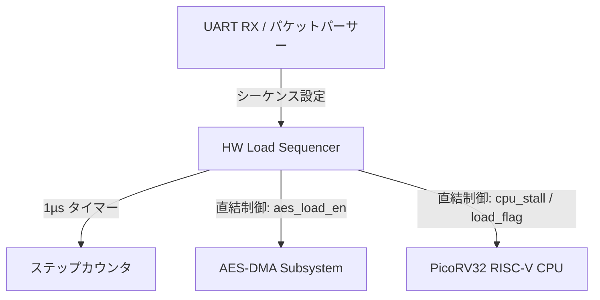

# VDRV_v1 アーキテクチャ検討候補案仕様書 (Architecture Candidates Specification)

## 1. 概要

本ドキュメントは、RISC-V CPU と AES/PRNG 暗号ストレスコアを搭載した LSI テストベッド **`VDRV_v1` (Voltage Drop on RISC-V v1)** における外部ホスト制御（UART）および負荷シーケンス制御の 2 つのアーキテクチャ候補案を比較・提示するものです。

IR-Drop（動的電源電圧降下）および $di/dt$ （過渡電流変化率）ノイズの評価目的に応じて選定または統合を検討します。

---

## 2. 負荷ステート定義

すべての候補案において、以下の 4 つの動作負荷ステートを制御対象とします：

| ステート | 状態名 | CPU 動作 | AES / PRNG 動作 | 主な過渡・電力特性 |
| :---: | :--- | :--- | :--- | :--- |
| `00` | **IDLE** | 待機状態 (WFI / Low Activity) | アイドル (AES/PRNG停止) | 最小消費電力 (ベースライン) |
| `01` | **AES_FULL** | 待機状態 (WFI / Low Activity) | 高負荷モード (PRNG -> AES 連続) | AESデータパス連続トグル電力 |
| `10` | **CPU_FULL** | 高負荷ループ (ALU/SRAM連打) | アイドル (AES/PRNG停止) | CPUパイプライン・バスフル稼動電力 |
| `11` | **BOTH_FULL** | 高負荷ループ (ALU/SRAM連打) | 高負荷モード (PRNG -> AES 連続) | システム最大消費電力 (最大IR-Drop) |

---

## 3. アーキテクチャ候補案

### 候補案 A: ハードウェア直結型シーケンサ構成 (HW-Direct Sequencer)

#### 概念と特徴
専用のハードウェアシーケンサ（`load_sequencer` モジュール）が 1µs 単位のクロックタイマーとシーケンス記憶テーブル（最大16ステップ）を保有し、**CPUを介入させずに直接 AES の `LOAD_MODE_EN` および CPU の `LOAD_STATE` / スリープ信号を全自動で制御**します。

#### システム構成図


#### 長所 (Advantages)
1. **純粋な単体電力測定**: `AES_FULL` ステートや `IDLE` ステート時に CPU が完全に停止状態（WFI）を維持できるため、CPU のスイッチングノイズが混入しない純粋な波形が得られる。
2. **サイクル・エグザクトな時間精度**: 100MHz クロック動作時、1 クロック（10ns）の誤差もない正確な ~100µs 保持時間を維持できる。
3. **CPU処理オーバヘッドゼロ**: シーケンス実行中に CPU パワーを一切浪費しない。

#### 短所 (Disadvantages)
1. ステート遷移時に CPU の割込み起床による急激な $di/dt$ （電流変化スパイク）が発生しないため、静的な電力ステップ検証寄りの波形となる。

---

### 候補案 B: CPU割込み連動型・過渡外乱構成 (CPU Interrupt-Driven Transient)

#### 概念と特徴
ハードウェアタイマーがステート保持時間 (~100µs) の完了時に **CPUへ割込み（IRQ）を発行** します。CPU の割込みハンドラ（ISR）が起動し、MMIO レジスタ操作によって自らの動作ループ切り替え（高負荷算術ループ ↔ WFI待機）および AES の起動・停止を行います。

#### システム構成図
```mermaid
graph TD
    UART_RX[UART RX / パケットパーサー] -->|MMIO 設定| REG[MMIO レジスタ / タイマー]
    REG -->|100µs 定時割込み (IRQ)| CPU[PicoRV32 RISC-V CPU]
    
    CPU -->|ISR内でMMIOアクセス| AES[AES-DMA Subsystem]
    CPU -->|ISR内で実行モード変更| LOOP[高負荷演算ループ / WFI待機]
```

#### 長所 (Advantages)
1. **高 $di/dt$ スパイクの創出**: WFI 停止中の CPU が割込みによって一瞬で全速稼動を開始することで、極めて大きな過渡電流変化率（$di/dt$）と L·(di/dt) 電源ノイズスパイクを意図的に生成可能。
2. **現実的な SOC 動作の模倣**: 実際のシステムにおける「割込み処理に伴う急激な電力急増」を精密に再現・評価できる。

#### 短所 (Disadvantages)
1. `AES_FULL` や `IDLE` のステート切替前後に、CPU の割込み処理（ISR）に伴う命令フェッチ・レジスタ退避電流ノイズが不可避的に混入する。
2. 割込み応答遅延やバス競合により、ステート切替時間に数十クロックのジッター（ブレ）が生じる。

---

### 候補案 C (推奨): 双方向統合ハイブリッド構成 (Dual-Mode Hybrid)

#### 概念と特徴
候補案 A と 候補案 B の利点を両立するため、`load_sequencer` に **モード切替ビット (`CTRL.IRQ_MODE`)** を導入する構成です。

- **`IRQ_MODE = 0` (HW直結ノイズ分離モード)**:
  候補案 A として動作。CPU に割込みを入れず、クロック精度の純粋なステート分離と静的 IR-Drop 解析を行う。
- **`IRQ_MODE = 1` (CPU割込み $di/dt$ 外乱モード)**:
  候補案 B として動作。ステート切替時に CPU 割込みを発行し、CPU の Sleep ↔ Active 遷移に伴う急激な $di/dt$ 電源サージノイズを発生させる。

---

## 4. 結論および選定のご案内

`VDRV_v1` テストベッドにおいては、単一の LSI 実装で「静的ノイズ分離」と「動的 $di/dt$ 外乱」の両方を柔軟に評価できる **候補案 C (双方向統合ハイブリッド構成)** を強く推奨いたします。
