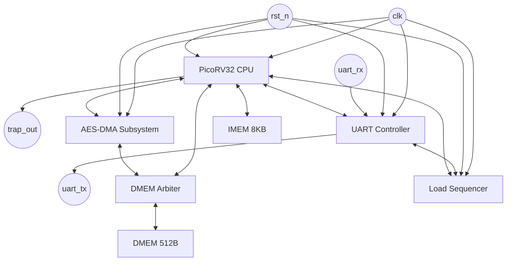

# VDRV_v1 トップレベルシステム仕様書

## 1. システムブロック図

本システム (VDRV_v1) の全体構成を以下のブロック図に示す。

## 2. トップレベルI/Oピン仕様

VDRV_v1モジュールのトップレベル入出力ピン一覧を以下に示す。

| ピン名 | 入出力 | 幅(bit) | 説明 |
| :--- | :--- | :--- | :--- |
| `clk` | Input | 1 | システムクロック (想定周波数: 100MHz) |
| `rst_n` | Input | 1 | システムリセット (負論理、アクティブロー) |
| `uart_rx` | Input | 1 | UART受信データ入力 |
| `uart_tx` | Output | 1 | UART送信データ出力 |
| `trap_out` | Output | 1 | PicoRV32 CPUトラップ状態出力 |

## 3. メモリマップ

システムの全体メモリマップを以下に示す。

| ベースアドレス | 終了アドレス | サイズ | モジュール/領域名 | 説明 |
| :--- | :--- | :--- | :--- | :--- |
| `0x0000_0000` | `0x0000_07FF` | 2KB | DMEM | 共有データSRAM (PicoRV32/AES-DMA共有) |
| `0x8000_0000` | `0x8000_0048` | 76B | AES/PRNG DMA MMIO | AESおよびPRNG DMA用メモリマップドI/O |
| `0x8000_0100` | `0x8000_0140` | 68B | UART & Load Sequencer | UART制御および負荷シーケンサ制御用MMIO |

※IMEM(8KB)は命令フェッチ専用のメモリ空間にマッピングされる前提とする。
