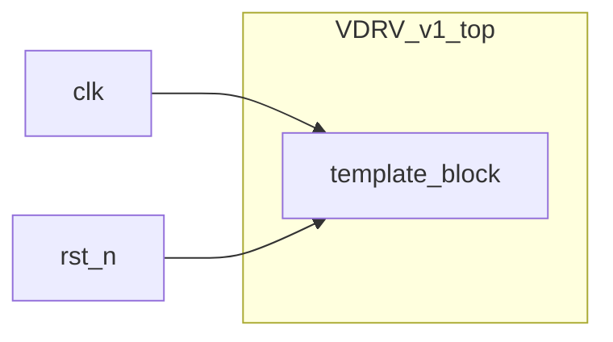

# トップレベルシステム仕様書 (System Architecture Specification)

**担当専門家**: System Architect (`system_architect`)  
**対象モジュール**: `VDRV_v1_top`

---

## 1. システム概要
本サブプロジェクト (`VDRV_v1`) はマルチブロック開発および検証用プロジェクトです。

---

## 2. トップレベルブロック図 (Block Diagram)

---

## 3. ピン定義

| 信号名 | 方向 | ビット幅 | 説明 |
| :--- | :--- | :--- | :--- |
| `clk` | Input | 1 | システムクロック |
| `rst_n` | Input | 1 | 非同期リセット |
| `in_valid` | Input | 1 | 入力有効フラグ |
| `in_data` | Input | 128 | 入力データ |
| `out_valid` | Output | 1 | 出力有効フラグ |
| `out_data` | Output | 128 | 出力データ |
