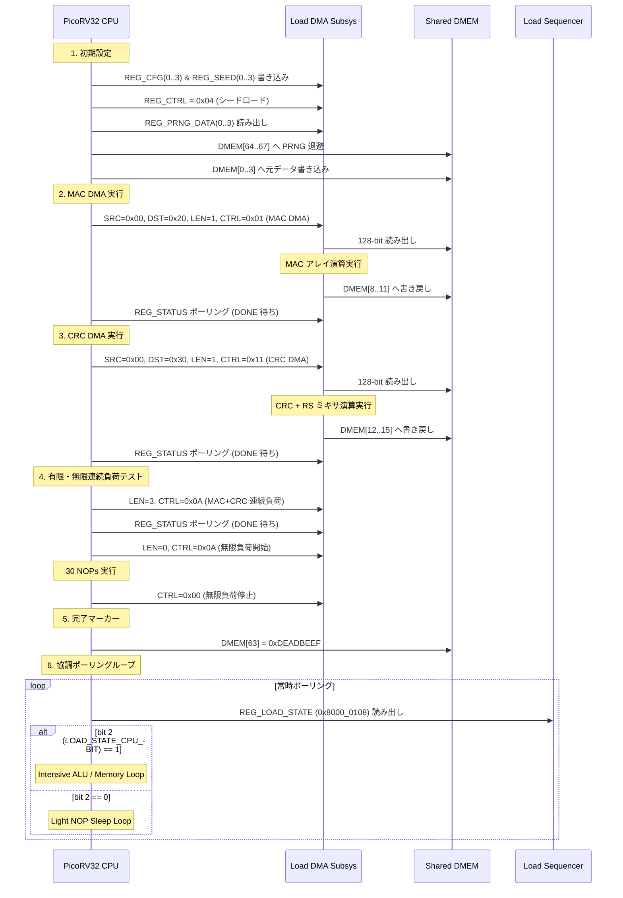

# VDRV_v1a ファームウェア設計仕様書 (Firmware Specification)

## 1. 概要 (Overview)

本ドキュメントは、`VDRV_v1a` システム上で動作する RISC-V 32-bit (RV32I) ベアメタルファームウェアの設計仕様を定義します。
ファームウェアの主な役割は以下の通りです：
1. **ブート & 自己診断テスト (Self-Test)**:
   - PRNG シードおよび演算コンフィグレーションの設定。
   - MAC DMA 転送テスト（単一ブロック演算および DMEM 書き戻し）。
   - CRC DMA 転送テスト（単一ブロック演算および DMEM 書き戻し）。
   - 有限ブロック連続負荷モードの動作確認。
   - 無限連続負荷モードの開始および手動停止シーケンスの確認。
   - 完了マーカー (`DMEM[63] = 0xDEADBEEF`) の書き込み。
2. **協調負荷追従メインループ**:
   - `load_sequencer` の状態レジスタ `REG_LOAD_STATE` (`0x8000_0108`) をポーリングし、CPU 負荷フラグ (`bit [2]`) に応じて高電力 ALU/メモリ連打ループと低電力待機ループを切り替え。

---

## 2. メモリマップ & MMIO 定義

### 2.1 共有データメモリ (Shared DMEM)
* アドレス: `0x0000_0000` - `0x0000_01FF` (512 バイト, 128 words)
* `DMEM[0..3]` : DMA 送信元データブロック (Plaintext)
* `DMEM[8..11]` : MAC DMA 処理結果格納バッファ (`0x0000_0020`)
* `DMEM[12..15]` : CRC DMA 処理結果格納バッファ (`0x0000_0030`)
* `DMEM[63]` : 自己診断完了通知マジックナンバー (`0xDEADBEEF`)
* `DMEM[64..67]` : PRNG 読み出しデータ退避領域 (`0x0000_0100`)
* `DMEM[100..115]` : 高負荷 ALU/メモリ連打ループ用作業領域

### 2.2 Load DMA Subsystem MMIO (`0x8000_0000` - `0x8000_0048`)

| オフセット | レジスタ名 | アクセス | 説明 |
| :--- | :--- | :---: | :--- |
| `0x00` | `REG_CTRL` | R/W | 制御レジスタ<br>- bit 0: DMA 開始パルス (`0x01`)<br>- bit 1: SW MAC 負荷モード有効<br>- bit 2: PRNG シードロードパルス (`0x04`)<br>- bit 3: SW CRC 負荷モード有効<br>- bit [5:4]: DMA モード選択 (`2'b00`: MAC, `2'b01`: CRC) |
| `0x04` | `REG_STATUS` | R | ステータスレジスタ<br>- bit 0: DMA 処理中 (Busy)<br>- bit 1: 処理完了フラグ (Done, 1 で完了)<br>- bit 2: 負荷コア稼働中 |
| `0x10` - `0x1C` | `REG_CFG(0..3)` | R/W | 128-bit コア設定パラメータ（MAC 係数 / CRC 初期多項式） |
| `0x20` - `0x2C` | `REG_SEED(0..3)` | R/W | 128-bit LFSR PRNG 初期シード |
| `0x30` - `0x3C` | `REG_PRNG_DATA(0..3)` | R | 128-bit PRNG 現在出力値 |
| `0x40` | `REG_SRC_ADDR` | R/W | DMA 転送元バイトアドレス (DMEM 内) |
| `0x44` | `REG_DST_ADDR` | R/W | DMA 転送先バイトアドレス (DMEM 内) |
| `0x48` | `REG_LEN` | R/W | DMA 転送ブロック数 (16 バイト単位。0 の場合は無限連続モード) |

### 2.3 Load Sequencer MMIO (`0x8000_0100` - `0x8000_0108`)

| オフセット | レジスタ名 | アクセス | 説明 |
| :--- | :--- | :---: | :--- |
| `0x00` | `REG_UART_TX` | W | UART 送信データレジスタ |
| `0x04` | `REG_UART_RX` | R | UART 受信データレジスタ |
| `0x08` | `REG_LOAD_STATE` | R | 現在の負荷ステート (`bit [2]`: CPU_EN, `bit [1]`: CRC_EN, `bit [0]`: MAC_EN) |

---

## 3. 負荷状態ビット定義

```c
#define LOAD_STATE_CPU_BIT   0x4  // Bit 2: CPU 高負荷アクティビティ
#define LOAD_STATE_CRC_BIT   0x2  // Bit 1: CRC コア高負荷アクティビティ
#define LOAD_STATE_MAC_BIT   0x1  // Bit 0: MAC コア高負荷アクティビティ
```

---

## 4. 実行シーケンスフロー


