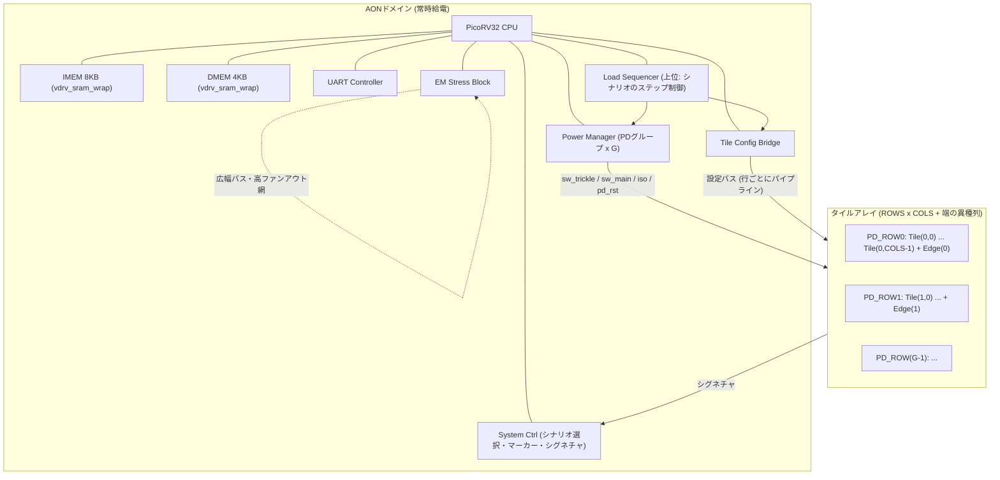
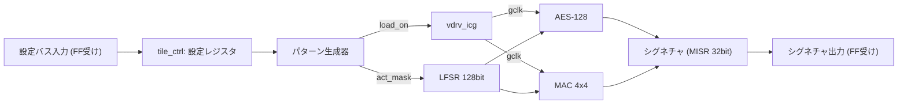
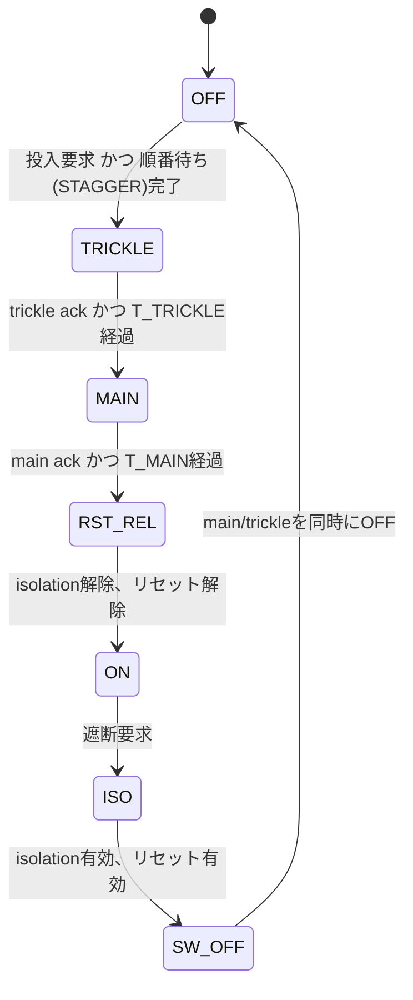

# VDRV_v3 トップレベルシステム仕様書

## 0. 目的と前提

VDRV_v3は、商用PDK環境でEM/IR解析ツールを評価するための大規模テスト回路である。
VDRV_v2（PicoRV32＋AES、単一PD）を基に、**負荷タイルのアレイ化**、**複数電源ドメインと2段階パワースイッチ制御**、**サイクル単位の負荷パターン生成**、**EMストレス用の構造**を追加する。

| 項目 | 内容 |
|:--|:--|
| 目標規模 | 10万〜100万インスタンス（パラメータで切り替え） |
| 用途 | 解析専用（テープアウトなし、GDS/DEFまで） |
| 主な評価対象 | 動的IR（ベクタあり / vectorless）、電源投入時の突入電流、電源網EM、信号線EM、IRを考慮したSTA |
| インプリ | フラット。タイル境界はFFで受け、将来ハードマクロ化できる構造にする |
| 電源電圧 | 単一電圧（level shifterなし） |
| クロック | 単一クロック `clk`。タイルごとにICGでゲーティング |

---

## 1. システムブロック図



---

## 2. 規模パラメータ

### 2.1 トップパラメータ

| パラメータ | ローカル既定値 | 商用既定値 | 説明 |
|:--|:--:|:--:|:--|
| `TILE_ROWS` | 2 | 8 | タイルの行数。**1行＝1 PDグループ** |
| `TILE_COLS` | 2 | 4 | 1行あたりの標準タイル数 |
| `EDGE_COL_EN` | 1 | 1 | 端に異種タイル列を1列追加するか |
| `MAC_ROWS` / `MAC_COLS` | 4 / 4 | 4 / 4 | タイル内MACアレイのサイズ |
| `EM_BUS_WIDTH` | 32 | 128 | EMストレス用広幅バスの幅 |
| `EM_FANOUT` | 64 | 256 | 高ファンアウト網の負荷数 |

PDグループ数 `G = TILE_ROWS` とする（商用既定値で8グループ。合意範囲の4〜8に含まれる）。

### 2.2 規模の目安

Yosysの汎用セル数で見積もった概算値。標準タイル1個 ≈ 2.1万セル（AES 1.1万＋MAC 4×4 0.77万＋LFSR 0.07万＋制御 約0.1万）、AON ≈ 1.5万セルとして計算した。商用ライブラリではバッファやCTSの影響で±30%程度変わる。

| 構成 (ROWS×COLS＋端列) | 標準タイル数 | 概算インスタンス数 | 用途 |
|:--|:--:|:--:|:--|
| 2×2＋2 | 4 | 約10万 | ローカル検証（LibreLane） |
| 4×4＋4 | 16 | 約37万 | 商用での初回トライアル |
| **8×4＋8** | **32** | **約70万** | **商用既定値** |
| 8×6＋8 | 48 | 約105万 | 上限側の評価 |

---

## 3. タイル仕様

### 3.1 タイルの種類

| 種類 | `TILE_TYPE` | 構成 | 役割 |
|:--|:--:|:--|:--|
| 標準タイル | 0 | AES-128コア＋128bit LFSR＋MACアレイ＋タイル制御 | 高トグル負荷の主力。全タイル同一構造で、対称性のチェックに使う |
| 低活性タイル | 1 | タイル制御＋大量のFF（クロックのみ、データはほぼ固定） | クロック負荷が主の領域。IRの小さい領域の比較対象 |
| SRAMタイル | 2 | タイル制御＋`vdrv_sram_wrap`（読み書きを連続実行） | マクロのピン付近のIR/EMを評価 |

端の異種列は、行ごとに低活性タイルとSRAMタイルを交互に並べる（偶数行＝低活性、奇数行＝SRAM）。

### 3.2 タイル内部構成（標準タイル）



- **境界のFF受け**：設定バス入力とシグネチャ出力は、タイル境界ですべてFFで受ける。
- **活性率の制御**：LFSR出力のうち `act_mask` で有効になったビットだけを更新し、残りのビットは前の値を保持する。これにより、AES/MACへの入力のトグル率を 0/16〜16/16 の段階で変えられる。
- **負荷のON/OFF方式**（`GATE_MODE`）
  - `0`：データ保持方式。クロックは動かしたまま入力を固定する（クロック網の電流は残る）
  - `1`：クロックゲーティング方式。ICGでクロックを止める（di/dtが最大になる）
- **シグネチャ**：AESの出力とMACの累積値をMISRで圧縮する。同じ設定なら決まった値になるので、正常に動作したかを確認できる。

### 3.3 パターン生成器（下位層）

タイルごとに1個持つ。時間の単位はすべて `clk` のサイクル。

| レジスタ | 幅 | 説明 |
|:--|:--:|:--|
| `PG_MODE` | 2 | 0: OFF、1: 常時ON、2: 周期パターン、3: ランダムバースト（LFSRでON/OFFを決める） |
| `PG_PERIOD` | 16 | 周期（サイクル）。周期パターンで使用 |
| `PG_DUTY` | 16 | 1周期のうちONのサイクル数 |
| `PG_PHASE` | 16 | 同期パルスからの位相オフセット（サイクル） |
| `ACT_LEVEL` | 5 | 活性率 0〜16（/16） |
| `GATE_MODE` | 1 | 0: データ保持、1: クロックゲーティング |

- **同期パルス `pg_sync`**：全タイル共通。AONから配り、受け取ったタイルは位相カウンタを `PG_PHASE` に戻す。全タイルの `PG_PHASE` を同じにすれば一斉にON、ずらせば段階的にONになる。
- **共振の励起**：`PG_PERIOD` をPDN共振周波数に合わせる（例：clk 500MHz、共振 50MHzなら `PG_PERIOD`=10）。

### 3.4 タイル設定バス

- AONの Tile Config Bridge から、行ごとにパイプライン化したバスで配る。
- 信号：`cfg_valid`、`cfg_tile_id[7:0]`（`0xFF`＝全タイル同時）、`cfg_addr[3:0]`、`cfg_wdata[31:0]`
- 読み出し：シグネチャ読み出しのみ。行ごとの読み出しチェーンでAONへ返す（遅くてよい）。
- 電源OFF中のタイルへの書き込みは無視される。PDがONになった直後は、リセット値から設定し直す必要がある。

---

## 4. 電源ドメインとパワースイッチ制御

### 4.1 ドメイン構成

| ドメイン | 中身 | 状態 |
|:--|:--|:--|
| `PD_AON` | CPU、メモリ、UART、System Ctrl、Load Sequencer、Power Manager、Config Bridge、EM Stress Block | 常時ON |
| `PD_ROW[g]` (g=0..G-1) | 行gのタイル（標準＋端列） | スイッチで切替 |

- 電源OFF時に状態は保持しない（retention FFは使わない）。
- 出力（シグネチャ読み出しチェーン）はAON側でisolationを入れ、0に固定する。
- RTLシミュレーションでは、v2と同じく `POWER_AWARE_SIM` を定義すると、OFF中のPD出力がXになる。

### 4.2 PDごとの制御信号（Power Manager → 物理側）

| 信号 | 方向 | 説明 |
|:--|:--|:--|
| `sw_trickle_en[g]` | out | 弱いスイッチ（trickle）チェーンのイネーブル |
| `sw_trickle_ack[g]` | in | trickleチェーン末端からのack |
| `sw_main_en[g]` | out | 強いスイッチ（main）チェーンのイネーブル |
| `sw_main_ack[g]` | in | mainチェーン末端からのack |
| `iso_en[g]` | out | isolationのイネーブル |
| `pd_rst_n[g]` | out | PD内部のリセット |

信号の極性（active-low / high）は、商用ライブラリのスイッチセルに合わせて最上位のラッパーで変換する。コア内部はすべて active-high のイネーブルで統一する。

### 4.3 投入シーケンス



### 4.4 Power Managerのレジスタ

| レジスタ | 説明 |
|:--|:--|
| `PD_REQ` | PDごとのON/OFF要求（ビットマスク） |
| `PD_STATUS` | PDごとの状態（OFF / 遷移中 / ON） |
| `T_TRICKLE` | trickle ON から main ON までの最小待ちサイクル |
| `T_MAIN` | main ON からリセット解除までの最小待ちサイクル |
| `STAGGER` | 複数PDを順にONにするときの間隔（サイクル）。0なら同時 |
| `PD_ORDER` | ONにする順番（4bit × 8エントリ） |
| `UNSAFE_MODE` | 1にすると、trickleとmainを同時にONし、ackを待たない（突入電流の**悪い例**） |

これらを組み合わせることで、同じネットリストのまま、突入電流の「良い例（段階投入）」と「悪い例（一斉投入）」の両方のシナリオを作れる。

### 4.5 RTLシミュレーションでのack

ackは物理側のスイッチチェーンから返ってくる信号なので、RTLシミュレーションでは遅延を持たせた振る舞いモデル `vdrv_pwr_switch_model`（テストベンチ側）で返す。

---

## 5. EMストレス用構造（EM Stress Block）

AONの中に置き、レジスタでON/OFFできる。

| 構造 | 内容 | 物理側での扱い |
|:--|:--|:--|
| 広幅高トグルバス | `EM_BUS_WIDTH` ビットの送信FF群から受信FF群へ。毎サイクル `0101…` と `1010…` を交互に出す（最大トグル）。受信側はシグネチャに取り込む | 送信FF群と受信FF群をダイの対角に配置し、長い配線にする |
| 高ファンアウト網 | 1個のFFが `EM_FANOUT` 個の受信FFを駆動し、毎サイクル反転する | バッファ挿入を制限（`dont_touch` / 最大ファンアウトの例外設定）し、大きなドライバを割り当てる |

レジスタ：`EM_CTRL`（bit0: バスEN、bit1: ファンアウト網EN、bit2: バスのパターン 0=交互反転 / 1=LFSR）

---

## 6. 負荷制御の2層構成とシナリオ

### 6.1 上位層：Load Sequencer（v2から拡張）

v2のLoad Sequencer（0.5µs単位、16ステップ）を拡張し、各ステップに次の内容を持たせる。

| フィールド | 説明 |
|:--|:--|
| `DURATION` | ステップの長さ（tick単位） |
| `PROFILE_ID` | タイル設定プロファイルの番号（プロファイルの中身はファームウェアが事前に書き込む） |
| `PD_REQ` | このステップでのPD要求マスク |
| `MARKER` | マーカー出力の値（解析する区間の目印） |
| `EM_CTRL` | EMストレス構造のON/OFF |

ステップが切り替わると、Load Sequencerは Config Bridge と Power Manager にハードウェアで直接指示を出す（v2のHW-Direct Modeと同じ）。CPU-IRQ Modeも残す。

### 6.2 シナリオの選択と自動実行

- トップピン `scenario_sel[3:0]` でシナリオ番号を選ぶ。
- リセットを解除すると、ファームウェアが `scenario_sel` を読み、対応するプロファイルとステップ表を書き込んで自動で実行する。
- UARTは、シナリオ表にない任意の設定をするために残す。

### 6.3 観測用の出力ピン

| ピン | 幅 | 説明 |
|:--|:--:|:--|
| `marker` | 2 | 解析する区間の目印（ステップの `MARKER` 値）。ベクタの切り出し位置に使う |
| `scenario_done` | 1 | シナリオ完了 |
| `sig_ok` | 1 | 全タイルのシグネチャを集計した値が期待値と一致 |
| `sig_out` | 8 | シグネチャを畳み込んだ値（デバッグ用） |

### 6.4 シナリオ一覧（初版）

| 番号 | 名前 | 内容 | 主な評価対象 |
|:--:|:--|:--|:--|
| 0 | IDLE | 全PD ON、全タイルOFF（クロックゲーティング） | 静的な基準 |
| 1 | ALL_ON_SYNC | 全タイルを同時に常時ON、活性率 16/16 | 動的IRの最悪ケース、vectorlessとの比較 |
| 2 | STEP_LOAD | 全タイルOFF→同時にON（クロックゲーティングの一斉解除） | di/dt |
| 3 | STAGGERED | `PG_PHASE` をタイルごとにずらしてON | 対策の効果の比較 |
| 4 | RESONANCE | 全タイルを周期パターンで同期させて励起（`PG_PERIOD` はレジスタで指定） | 共振、動的IR |
| 5 | HOTSPOT | 1タイルだけ活性率 16/16、他は0 | 局所的な電圧降下 |
| 6 | CHECKER | 市松模様でON/OFF | 位置のパターン |
| 7 | MOVING_HOT | ホットスポットをステップごとに隣のタイルへ移動 | 時間と位置の変化 |
| 8 | PWRUP_SAFE | 全PDを `STAGGER` ありの2段階投入でON | 突入電流（良い例） |
| 9 | PWRUP_UNSAFE | `UNSAFE_MODE`＝1、全PDを一斉にON | 突入電流（悪い例） |
| 10 | PWRUP_NEIGHBOR | PD_ROW0をフル負荷で動かしたまま、PD_ROW1を投入 | ドメイン間の干渉 |
| 11 | EM_STRESS | EMストレス構造をON＋全タイルを常時ON | 信号線EM、電源網EM |

---

## 7. メモリマップ

| ベースアドレス | 終了アドレス | ブロック | 説明 |
|:--|:--|:--|:--|
| `0x0000_0000` | `0x0000_0FFF` | DMEM | 4KB。`vdrv_sram_wrap` を使用 |
| `0x8000_0000` | `0x8000_00FF` | System Ctrl | `scenario_sel` の読み出し、マーカー、完了フラグ、シグネチャの集計 |
| `0x8000_0100` | `0x8000_01FF` | Load Sequencer | ステップ表、制御 |
| `0x8000_0200` | `0x8000_02FF` | Power Manager | 4.4節のレジスタ |
| `0x8000_0300` | `0x8000_03FF` | Tile Config Bridge | タイル設定バスへの書き込み、シグネチャの読み出し、`pg_sync` の発行 |
| `0x8000_0400` | `0x8000_04FF` | EM Stress Block | `EM_CTRL` |
| `0x8000_0500` | `0x8000_05FF` | UART | 送受信 |

IMEM（8KB）は命令フェッチ専用の空間に置く（v2と同じ）。

---

## 8. トップレベルI/Oピン

| ピン名 | 入出力 | 幅 | 説明 |
|:--|:--|:--:|:--|
| `clk` | In | 1 | システムクロック |
| `rst_n` | In | 1 | リセット（負論理） |
| `scenario_sel` | In | 4 | シナリオ番号 |
| `uart_rx` / `uart_tx` | In / Out | 1 / 1 | UART |
| `marker` | Out | 2 | 解析区間の目印 |
| `scenario_done` | Out | 1 | シナリオ完了 |
| `sig_ok` | Out | 1 | シグネチャの照合結果 |
| `sig_out` | Out | 8 | シグネチャを畳み込んだ値 |
| `sw_trickle_en` / `sw_trickle_ack` | Out / In | G / G | パワースイッチ（trickle） |
| `sw_main_en` / `sw_main_ack` | Out / In | G / G | パワースイッチ（main） |

パワースイッチ関連の信号は、商用環境ではコアの内部でスイッチセルに接続する（ピンに出すのはローカル検証とRTLシミュレーションのため）。`iso_en` と `pd_rst_n` はコアの内部だけで使う。

---

## 9. PDKに依存するセルのラッパー

RTLはPDKに依存しない形を保ち、商用環境ではラッパーの中身だけを差し替える。

| ラッパー | RTLでの中身 | 商用環境での差し替え先 |
|:--|:--|:--|
| `vdrv_sram_wrap` | 振る舞いモデル（レジスタ配列） | メモリコンパイラで生成したSRAMマクロ |
| `vdrv_icg` | ラッチ＋ANDの振る舞いモデル | ライブラリのICGセル |
| `vdrv_iso_and` | AND | ライブラリのisolationセル（またはUPFで自動挿入） |

差し替えの対応表、UPF、SDCの雛形は `impl/commercial/` に置く（ファイル構成は第11章）。

---

## 10. クロックとタイミング

- 単一クロック `clk`。目標周波数は、スタンダードセルを使うノードで決まるため、パラメータとして扱う。
  - ローカル（sky130 / LibreLane）：100MHz（v2と同じ）
  - 商用：初回トライアルで得られたfmaxの約90%に設定し、タイミングの余裕が少ない状態にする（IRを考慮したSTAの評価のため）
- パターン生成器の時間はすべてサイクル単位なので、周波数を変えてもRTLの変更は不要。
- Load Sequencerのtick長（v2では50サイクル＝0.5µs）はレジスタで変えられるようにする。

---

## 11. ディレクトリ構成（追加分）

```text
VDRV_v3/
├── blocks/
│   ├── load_tile/          # 新規: 標準/低活性/SRAMタイル、tile_ctrl、パターン生成器
│   ├── pwr_manager/        # 新規: 複数PD・2段階スイッチ制御（aes_power_managerを置き換え）
│   ├── tile_cfg_bridge/    # 新規: タイル設定バスのマスタ
│   ├── em_stress/          # 新規: EMストレス構造
│   ├── sys_ctrl/           # 新規: シナリオ選択、マーカー、シグネチャ集計
│   ├── load_sequencer/     # v2から拡張
│   ├── aes_core/ lfsr_prng/ picorv32_cpu/ uart_ctrl/   # v2から再利用
│   └── mac_array/          # mac_array_testから再利用
├── common/rtl/             # vdrv_sram_wrap, vdrv_icg, vdrv_iso_and, reset_sync
└── impl/commercial/        # UPF、SDC、セル差し替え表の雛形
```

v2の `aes_power_manager` と `aes_dma_subsys` は、`pwr_manager` とタイル内のLFSRによる自己駆動で置き換えるため、v3では使わない（`aes_power_manager` は参考として当面残す）。

---

## 12. 実装の順番

| フェーズ | 内容 | 完了の条件 |
|:--:|:--|:--|
| 1 | 共通ラッパー（`vdrv_icg` / `vdrv_sram_wrap`）、`load_tile`（パターン生成器を含む） | 単体シミュレーションで、活性率とパターンが仕様どおり |
| 2 | `tile_cfg_bridge`、タイルアレイ（2×2＋端列）をトップに統合 | 全タイルのシグネチャが一致 |
| 3 | `pwr_manager`（2段階スイッチ、STAGGER、UNSAFE）と isolation | 投入/遮断のシーケンスが仕様どおり（`POWER_AWARE_SIM`） |
| 4 | `em_stress`、`sys_ctrl`、Load Sequencerの拡張、ファームウェアのシナリオ | 全12シナリオがトップシミュレーションで完走 |
| 5 | ローカルでの合成とPnR（2×2、UPFなし）、`impl/commercial/` の雛形 | LibreLaneでDRC/LVSがクリーン |
