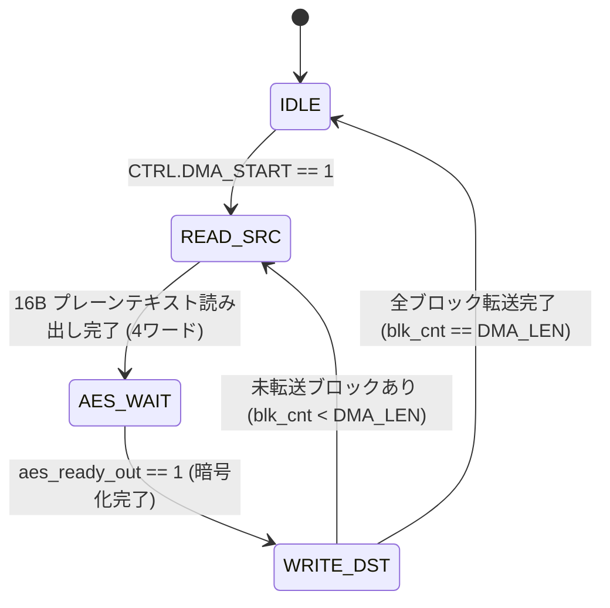

# AES-128 / PRNG DMA サブシステム仕様書 (`aes_dma_subsys`)

## 1. 概要

`aes_dma_subsys` モジュールは、MMIO（Memory-Mapped I/O）レジスタインタフェース、DMA コントローラ、AES 暗号化ローカルバッファ、および 128-bit LFSR PRNG モジュールをカプセル化した中核サブシステムです。

---

## 2. MMIO レジスタマップ (ベースアドレス: `0x8000_0000`)

| オフセット | レジスタ名 | R/W | ビット定義 / 機能記述 |
| :--- | :--- | :--- | :--- |
| `0x00` | `CTRL` | W | ビット[0]: `DMA_START` (1書き込みでDMA転送起動) ビット[1]: `LOAD_MODE_EN` (1でPRNG連続高負荷モード有効化) ビット[2]: `SEED_LOAD` (1書き込みでPRNGシード書き換えパルス発行) |
| `0x04` | `STATUS` | R | ビット[0]: `DMA_BUSY` (1: DMA転送中) ビット[1]: `DMA_DONE` (1: DMA転送完了) ビット[2]: `AES_BUSY` (1: AES暗号化処理中) |
| `0x10` | `AES_KEY0` | R/W | AES 鍵 [31:0] |
| `0x14` | `AES_KEY1` | R/W | AES 鍵 [63:32] |
| `0x18` | `AES_KEY2` | R/W | AES 鍵 [95:64] |
| `0x1C` | `AES_KEY3` | R/W | AES 鍵 [127:96] |
| `0x20` | `PRNG_SEED0`| R/W | PRNG シード [31:0] |
| `0x24` | `PRNG_SEED1`| R/W | PRNG シード [63:32] |
| `0x28` | `PRNG_SEED2`| R/W | PRNG シード [95:64] |
| `0x2C` | `PRNG_SEED3`| R/W | PRNG シード [127:96] |
| `0x30` | `PRNG_DATA0`| R | PRNG 現在出力 [31:0] （CPUリードバック用） |
| `0x34` | `PRNG_DATA1`| R | PRNG 現在出力 [63:32] |
| `0x38` | `PRNG_DATA2`| R | PRNG 現在出力 [95:64] |
| `0x3C` | `PRNG_DATA3`| R | PRNG 現在出力 [127:96] |
| `0x40` | `DMA_SRC` | R/W | DMA 転送元 SRAM アドレス (`0x0000_0000` 基準) |
| `0x44` | `DMA_DST` | R/W | DMA 転送先 SRAM アドレス (`0x0000_0000` 基準) |
| `0x48` | `DMA_LEN` | R/W | DMA 転送ブロック数（1ブロック = 16バイト） |

---

## 3. DMA コントローラ ステートマシン仕様

1. **IDLE**: アイドル状態。CPU からの MMIO アクセスを受信。
2. **READ_SRC**: `DMA_SRC` から 128 ビット（4 ワード）の平文データを `dmem` より自動で連続リードし、ローカルバッファ `line_buf_in` に格納。
3. **AES_WAIT**: `aes_start_in` パルスを発行し、AES暗号コアの完了信号 `aes_ready_out` を待ち合わせ（12 クロックサイクル）。
4. **WRITE_DST**: 暗号化された 128 ビットデータ `line_buf_out` を `DMA_DST` の SRAM アドレスへ 4 ワード連続ライト。

---

## 4. 高負荷 IR-Drop ストレスモード機能 (`LOAD_MODE_EN`)

`CTRL.LOAD_MODE_EN` ビット（`CTRL[1]`）を `1` に設定すると、PRNG 乱数列を AES に直接供給する高負荷モードに入ります。
本モードは `DMA_LEN` の設定値に応じて**自動復帰動作**または**連続動作**を行います：

1. **有限ブロック自動復帰動作 (`DMA_LEN > 0` の場合)**:
   - `LOAD_MODE_EN = 1` 起動時、`DMA_LEN` で設定したブロック数（16バイト× `DMA_LEN` 回）だけ AES 暗号化を高速連続実行します。
   - 指定ブロック数の処理が完了すると、**ハードウェアが自動的に `LOAD_MODE_EN`（`CTRL[1]`）を `0` にクリア**し、`STATUS.DMA_DONE`（ビット1）を `1` にアサートして通常モードに自動復帰します。
   - CPU は `STATUS` レジスタをポーリングすることで、高負荷ストレス印加の完了を検出可能です。

2. **無限連続動作 (`DMA_LEN == 0` の場合)**:
   - `DMA_LEN = 0` の状態で `LOAD_MODE_EN = 1` にすると、CPU が明示的に `LOAD_MODE_EN = 0` を書き込むまで、12 サイクル周期で無期限に全速暗号化処理を継続します。
   - 20 個の S-Box が連続トグルし、持続的な最大トグル率（IR-Drop ストレス）を供給し続けます。
