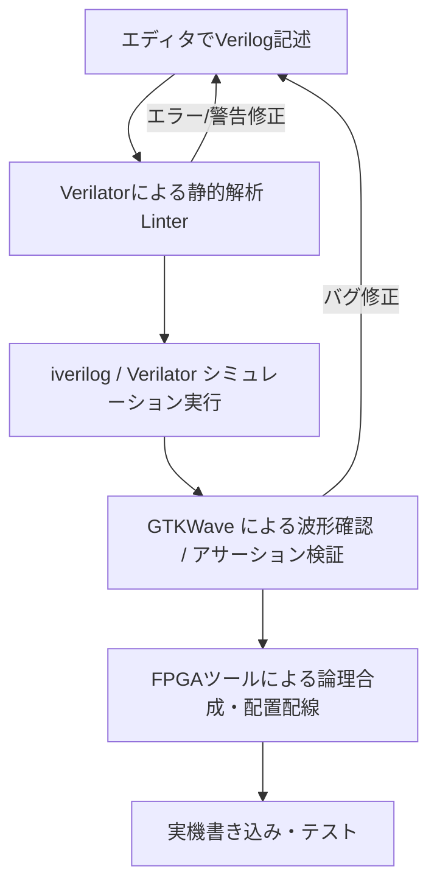

# Verilog HDL 設計のベストプラクティスとツールチェーン

Verilog HDLを用いた論理回路設計（LSI/FPGA設計）における、おすすめのツールチェーン、コーディングのベストプラクティス、および推奨されるワークフローをまとめました。

---

## 1. 推奨ツールチェーン (Toolchains)

設計の目的（シミュレーション、FPGA実装、LSI開発）や予算（オープンソース vs 商用）に応じて選択します。

### A. シミュレーション & 検証 (Simulation & Verification)
回路が意図通りに動くか確認するためのツールです。

*   **Verilator** (オープンソース・超高速)
    *   **特徴**: Verilog/SystemVerilog コードを C++ または SystemC に変換してコンパイルし、高速にシミュレーションを実行します。
    *   **用途**: 大規模なテストベンチの高速実行、ソフトウェア（C/C++）との協調検証。また、**静的解析（Linter）ツールとしても極めて優秀**です。
*   **Icarus Verilog (iverilog) + GTKWave** (オープンソース・手軽)
    *   **特徴**: IEEE1364規格に準拠したオープンソースのシミュレータ。波形ビューアの **GTKWave** と組み合わせて使用します。
    *   **用途**: 小〜中規模回路の素早いシミュレーション、学習・プロトタイピング。
*   **ModelSim / Questa** (Siemens製・業界標準)
    *   **特徴**: FPGAベンダーのツール（Intel Quartus等）にバンドルされている無償版（Starter/Lite Edition）から、商用ハイエンド版まで広く使われている業界標準シミュレータ。
*   **VCS (Synopsys) / Incisive, Xcelium (Cadence)**
    *   **特徴**: LSI（ASIC）設計で用いられる商用超高速シミュレータ。個人ユースでは利用困難ですが、プロの現場での主流です。

### B. 合成 & 実装 (Synthesis & Implementation)
回路を実際のゲートやFPGAのロジックセルにマッピングするツールです。

*   **FPGAベンダー純正ツール** (ターゲットFPGAに依存)
    *   **AMD (Xilinx)**: **Vivado Design Suite** (主要デバイス向け)
    *   **Intel (Altera)**: **Quartus Prime**
    *   **Lattice**: **Lattice Radiant** / **Diamond**
*   **Yosys + nextpnr** (完全オープンソース・FPGAフロー)
    *   **特徴**: オープンソースの論理合成ツール（Yosys）と配置配線ツール（nextpnr）。主にLattice ICE40やECP5などのFPGAを対象としたオープンソース開発環境で使われます。

### C. 静的解析 & フォーマッタ (Lint & Format)
コードのバグを事前に防ぎ、可読性を高めるツールです。

*   **Verilator**
    *   `verilator --lint-only -Wall -cc top.v` で実行し、合成不可能な記述や非推奨な記述を検出します。
*   **Verible** (Google製)
    *   SystemVerilog/Verilog用のパーサー、スタイルリンター、およびフォーマッタ。コード規約の統一に役立ちます。

---

## 2. コーディング・ベストプラクティス (Best Practices)

バグを未然に防ぎ、可読性と移植性が高く、意図した通りのハードウェアが合成されるための鉄則です。

### ① ブロッキング代入 (`=`) と 非ブロッキング代入 (`<=`) の使い分け
Verilog設計で最も重要なルールです。これを誤ると、シミュレーションと実機（合成後）で動作が異なるバグを引き起こします。

*   **順序回路（フリップフロップなど、クロック同期）**: **非ブロッキング代入 (`<=`)** を使用する。
*   **組み合わせ回路（マルチプレクサ、デコーダなど）**: **ブロッキング代入 (`=`)** を使用する。

```verilog
// 良い例：順序回路 (Sequential Logic)
always @(posedge clk or negedge rst_n) begin
    if (!rst_n) begin
        q <= 1'b0;
    end else begin
        q <= d; // 非ブロッキング代入を使用
    end
end

// 良い例：組み合わせ回路 (Combinational Logic)
always @(*) begin
    y = a & b; // ブロッキング代入を使用
end
```

### ② ラッチ (Latch) の発生を防ぐ
意図しないラッチ（非同期の記憶素子）が生成されると、タイミング解析や実機動作が不安定になります。
組み合わせ回路を記述する際は、**あらゆる条件での出力値（デフォルト値）を必ず定義**してください。

*   `if` 文を書くときは、必ず `else` を書く。
*   `case` 文を書くときは、必ず `default` を書く。
*   または、`always` ブロックの先頭でデフォルト値を代入しておく。

```verilog
// 悪い例：条件が網羅されておらず、y にラッチが生成される
always @(*) begin
    if (sel) begin
        y = a;
    end
    // else がないため、sel=0 の時に前の値を保持しようとしてラッチになる
end

// 良い例：デフォルト値を指定してラッチを回避
always @(*) begin
    y = 1'b0; // デフォルト値
    if (sel) begin
        y = a;
    end
end
```

### ③ リセット設計と非同期代入の制約
*   **非同期リセット（Active-Low推奨）**: リセット解除時のメタスタビリティ（タイミング違反）に注意が必要です。通常は、リセット解除部でのみクロックに同期させる「非同期駆動・同期解除」の設計を行います。
*   **非同期リセット条件下の定数代入の徹底（重要）**: `always @(posedge clk or negedge rst_n)` の `if (!rst_n)` ブロック内では、**必ず定数（例: `32'h0`）を代入してください**。入力信号や変数（例: `out <= seed_in`）を非同期リセット内で代入すると、PDKライブラリに存在しない非同期ロードフリップフロップ（`$_ALDFFE_*`）が生成され、PnR（配置配線）合成時に `Unmapped Cells` エラーで失敗します。

### ④ 多重ドライバ (Multiple Drivers) の回避
*   同一の `reg` 変数を複数の `always` ブロックから代入・更新することは Verilog 規格および合成上**厳禁**です。
*   レジスタの制御ロジック（MMIOライト、内部自動クリア、ステート更新等）は、必ず **1 つの `always` ブロック内に集約** してください。

### ⑤ 命名規則の統一
*   クロック信号: `clk`, `sys_clk`, `clk_100m`
*   リセット信号: `rst_n` (Active-Lowを示す `_n` や `_b` を付与)
*   モジュール名とファイル名を一致させる（例: `module my_design` は `my_design.v` に保存）。
*   パラメータ名は大文字にする (`parameter WIDTH = 8`)。

---

## 3. プレ合成チェック (Pre-Synthesis Check) による事前問題抽出

PnR（配置配線）の長時間の実行に進む前に、Yosys AST 展開および `check -assert` をスタンドアロンで超高速実行する「プレ合成チェック」を行うことで、多重ドライバや非標準セルの発生を **1秒未満** で確実に検出します。

```bash
# Yosys による超高速事前チェック
make presynth_check
```

*   **Verilator Lint フラグの厳格化**:
    `verilator --lint-only -Wall -Werror-MULTIDRIVEN -Wno-fatal` を実行し、多重駆動警告を事前捕捉します。

以下は、オープンソースツールを活用したローカル環境での効率的な開発サイクルです。



### クイックスタートコマンド例 (iverilog + GTKWave)

1.  **コンパイルとシミュレーション実行**
    ```bash
    # テストベンチ(tb_top.v)と設計ソース(top.v)をコンパイル
    iverilog -o sim.out tb_top.v top.v
    # シミュレーションの実行（VCD波形ファイルが出力される）
    vvp sim.out
    ```
2.  **波形ビューアの起動**
    ```bash
    gtkwave dump.vcd
    ```

---

## 4. 学習ステップと参考リソース

1.  **RTL設計と回路の意識**:
    *   Verilogを書くときは、プログラムを書いているのではなく「回路図を文字で描いている」という意識を持つことが最も大切です。
2.  **HDL Lintの導入**:
    *   自分でコードを書いたら、まず `verilator --lint-only` にかけてみましょう。初心者が陥りやすいミス（ビット幅の不一致、マルチドライブ、意図しないラッチ）の9割を検出してくれます。
3.  **SystemVerilogへの移行**:
    *   Verilog HDLの基本を学んだ後は、より安全で強力な **SystemVerilog**（`logic` 型、構造体、アサーションなど）へ移行することをお勧めします。現代のFPGA/LSI設計ではSystemVerilogが主流です。
