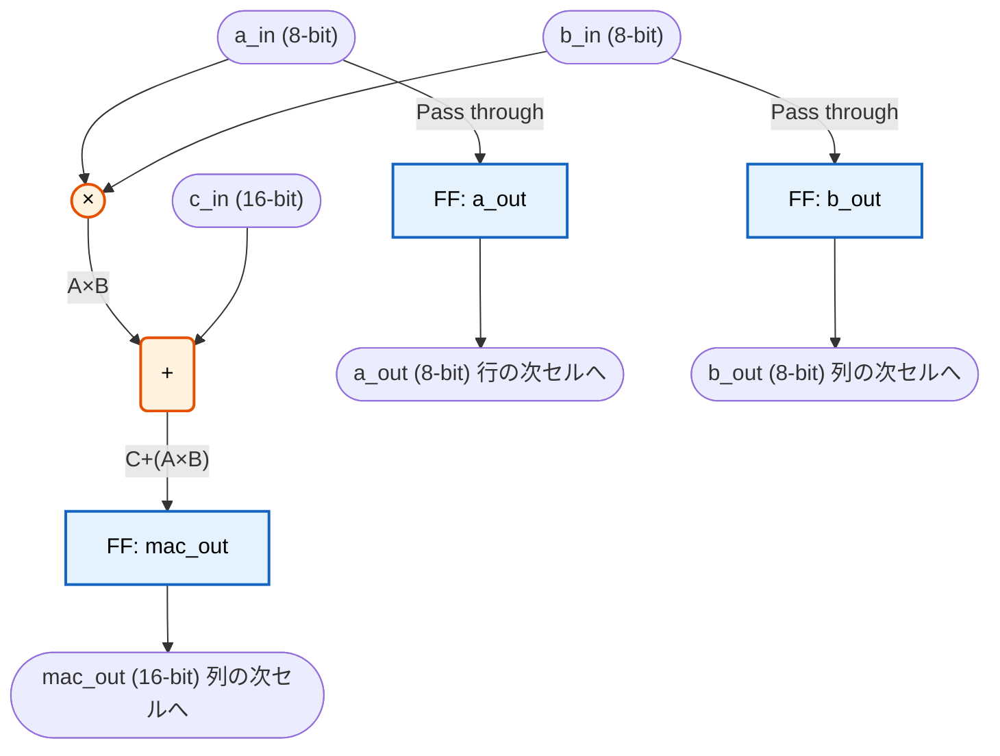
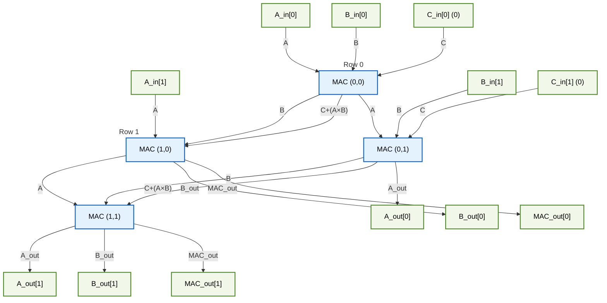

# MAC Unit Architecture

シストリック・アレイ（MACアレイ）を構成する最小単位のブロックである「MAC (Multiply-Accumulate: 積和演算) ユニット」のアーキテクチャについて説明します。

## 1. MAC演算器の基本動作
MACユニットは、名前の通り **「乗算（Multiply）」** と **「加算（Accumulate）」** を同時に行う回路です。

動作を数式で表すと、以下の計算を1クロックサイクルごとに行います。
`出力 = C + (A × B)`

さらに、シストリック・アレイとして全体を接続するために、計算に用いた入力値 `A` と `B` を、バケツリレーのようにそのまま次のセルへ受け渡す（パススルーする）役割も持っています。具体的には以下の3つの処理がレジスタ（フリップフロップ）を介してクロックに同期して同時に行われます。

1. **演算**: 入力 `a_in` と `b_in` を掛け合わせ、その結果を入力 `c_in`（前段からの部分和）に足し合わせて `mac_out` レジスタに保存する。
2. **データAの伝播**: 入力 `a_in` をそのまま `a_out` レジスタに保存し、横方向の次のセルへ渡す。
3. **データBの伝播**: 入力 `b_in` をそのまま `b_out` レジスタに保存し、縦方向の次のセルへ渡す。

## 2. 回路構成図
MACユニット単体の回路構成を概念図で表すと以下のようになります。青色の四角はクロックに同期してデータを保持するフリップフロップ（レジスタ）です。

## 3. アレイ全体の接続図 (2x2の例)
MACユニットを2行2列で配置し、`mac_array` を構成した際のデータの流れは以下のようになります。
* **データA**: 左辺から入力され、右へ伝播します。
* **データB**: 上辺から入力され、下へ伝播します。
* **データC (部分和)**: 上辺から入力（初期値0）され、計算されながら下へ伝播し、最下部から最終結果が出力されます。

## 4. PnRおよびIR-Drop解析における利点
この構成では、すべてのセルの中に「乗算器」「加算器」という**非常にロジック密度の高い組み合わせ回路**と、多数の「フリップフロップ」が存在します。

データが入力されると、アレイ全体のすべてのMACユニットが一斉に乗算と加算の計算を実行するため、チップ全体の電力網（Power Grid）に対して均一かつ非常に大きなダイナミック消費電力を発生させることができます。また、パラメータ（ROWS, COLS）によってアレイサイズを自由に変更できるため、EDAツールの処理能力に応じたストレステスト環境を容易に構築可能です。
